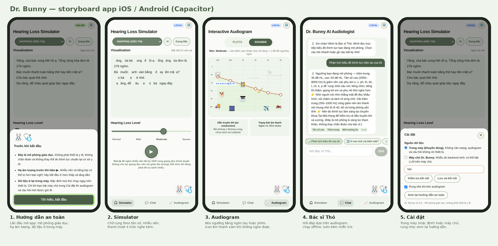
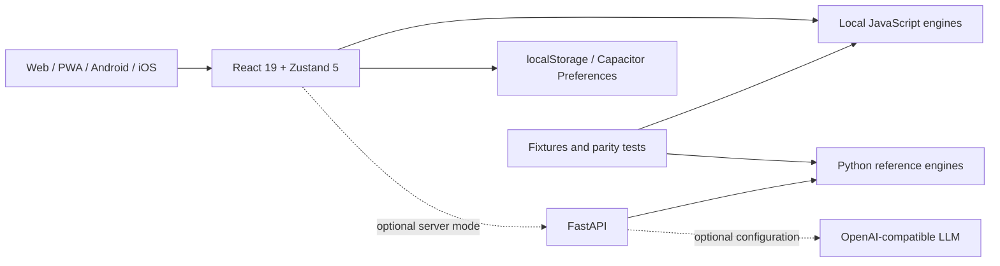

# HearAtlas

[Tiếng Việt — default](README.md) · **English** · [简体中文](README.zh-CN.md)

**Understand sound. Connect experiences.** An educational hearing product alpha, developed from Dr. Bunny demos and community/PTIT work. One React application supports web, PWA, Android and iOS; core features work on the device without a server.

[Web app](https://hdwc-151.github.io/Demo-hearing-loss/) · [Standalone demo](https://hdwc-151.github.io/Demo-hearing-loss/demo.html) · [Documentation](docs/README.md) · [Mobile guide](mobile/README.md) · [Dependency review](docs/maintenance/mobile-dependency-review.md)

> **Educational simulation, without clinical validation.** Do not use it to measure or diagnose hearing loss, prescribe treatment or fit hearing aids. Lower device volume before listening. Digital limiting does not guarantee safe sound pressure from headphones/speakers.



## Features and limits

| Component | Implemented behaviour | Limits |
| --- | --- | --- |
| Simulator | Normal/Mild/Moderate/Severe presets, listening scenarios, phoneme-based text illustration, TTS and procedural noise | VI/EN content, some northern/southern Vietnamese rules; TTS is not filtered through the audiogram |
| Audiogram Studio | Drag or use a keyboard to edit six thresholds from 250–8000 Hz, linked to Simulator | One simulated ear, air conduction; not a hearing measurement |
| Audio Lab | A: original, B: illustrative STFT/ERB/dcGC-shaped loss, C: educational EQ/WDRC; RMS, spectral centroid and high-frequency energy | ≤12 MB/8 seconds; ERB/dcGC/WDRC ≤4 seconds/48 kHz; processing uses the UI thread |
| Dr. Bunny | Sourced explanations, rule-based retrieval using an audiogram, optional server LLM | No separately trained assistant model; bunny expressions represent UI state |
| Offline/settings | JavaScript engines, PWA cache, native Preferences and browser localStorage | PWA needs a successful first load; no account/cloud synchronization |
| Apple Health preview | Explicitly requested bilateral audiogram reading on iPhone, held in memory | Native iOS only; no automatic saving, uploading or application to the simulation; device testing pending |
| Android/iOS | Committed native projects; CI builds Android debug APK and iOS Simulator | Signed releases, store distribution and real-device acceptance remain pending |

Hidden letters illustrate a rule, not an individual's exact hearing experience. dB HL is not directly interchangeable with dB SPL/dBFS. dcGC-shaped processing approximates spectral magnitude; it is not a validated causal Gammachirp filter. Educational EQ/WDRC processes the **original signal**, with at most +6 dB digital gain and a ±0.8 limiter. Procedural noise is not a trained GAN.

## Architecture and dependencies



| Layer | Components | Location |
| --- | --- | --- |
| UI/build | React 19.3.1, Zustand 5.0.16, Tailwind 3.4.17, Vite 6.4.6 | `frontend/src/`, `frontend/vite.config.js` |
| Local logic | VI/EN phonemes, FFT noise, STFT/ERB/dcGC/WDRC, GraphRAG | `frontend/src/util/`, `frontend/src/data/` |
| Native bridge | Capacitor 8.6.0 core/CLI/Android/iOS; App, Haptics, Preferences, SplashScreen, StatusBar | `frontend/src/native.js`, `storage.js`, `capacitor.config.json` |
| Assets | Capacitor Assets 4.0.0, icons/splashes and store materials | `mobile/`, `frontend/scripts/mobile.mjs` |
| Optional API | Python 3.12 in CI, FastAPI, Pydantic, NumPy, HTTPX, Uvicorn | `backend/main.py`, `backend/core/` |
| Tests | pytest, Node test, Python–JS fixtures, Playwright/Chromium, Gradle, Xcode | `tests/`, `frontend/scripts/`, `.github/workflows/` |

The inherited principles are **offline-first, server-optional** and **Python–JavaScript parity**. Actual frontend resolutions live in `frontend/package-lock.json`; native plugins have independent minor versions. `backend/requirements.txt` has lower bounds, not a lockfile. `requirements-tested.txt` is an older tested environment snapshot.

## Repository map

```text
frontend/src/         UI, store, API, local engines, HealthKit preview
frontend/public/      PWA manifest and service worker
frontend/android/     Gradle, manifest, MainActivity, Android resources
frontend/ios/         Xcode, SwiftPM, HealthKit bridge, privacy manifest
frontend/scripts/     Tests, parity, demo/mobile build commands
backend/              FastAPI and Python reference engines
tests/                pytest, fixtures, research and browser E2E
demo/index.html       Committed standalone file:// demo
mobile/               Build guide, icons/splashes, store materials
docs/                 Architecture, API, research, deployment and history
scripts/              API checks and repository helpers
legacy/               Preserved prototype
archive/              Historical implementations, documents and demos
.github/workflows/    CI, mobile, HealthKit, container and Pages
docker-compose.yml    nginx/web and backend
Makefile              Developer shortcuts
REPOSITORY_MAP.md     Directory provenance
```

Develop the current app in root `frontend/` and `backend/`. Archived `Master/`, `final/` and `Hearing/` are historical references.

## Install and run web

For an immediate offline demo, download the repository and open [`demo/index.html`](demo/index.html) in Chrome/Edge. No Node, Python or API is required. This is a committed snapshot. `npm run build:demo` rebuilds it from React and saves an older snapshot before overwriting it.

For development, install Git and Node.js **22+** with npm:

```sh
git clone https://github.com/hdwc-151/Demo-hearing-loss.git
cd Demo-hearing-loss/frontend
npm ci
npm run dev
```

Open `http://localhost:5173`. Choose **Cài đặt → Trong máy** for local operation. Web development defaults to `/api`; Vite proxies `/api/*` to `http://localhost:8000/*`. `npm run build` produces `frontend/dist/`. `npm run preview` serves that build with **no API proxy**. Public web deployments need a reverse proxy or a configured HTTPS API.

Pages builds use `VITE_BASE=/<repository-name>/` and `VITE_API_BASE=offline`. Set Pages Source to **GitHub Actions** and ensure deployment succeeds. PWA offline use requires a successful first load. Alternatively run `docker compose up --build` at repository root and open `http://localhost:8080`; nginx forwards `/api/` to the backend.

## Optional server/API

Local features require no account or API key. Use Python **3.12** for the API, from repository root:

```powershell
# Windows PowerShell
py -3.12 -m venv .venv
.\.venv\Scripts\Activate.ps1
python -m pip install -r backend/requirements.txt
python -m uvicorn main:app --app-dir backend --reload --port 8000
```

```sh
# macOS / Linux
python3.12 -m venv .venv
source .venv/bin/activate
python -m pip install -r backend/requirements.txt
python -m uvicorn main:app --app-dir backend --reload --port 8000
```

Check `http://localhost:8000/health`, Swagger at `/docs`, or run `python scripts/check_backend.py http://localhost:8000`.

| Server variable | Purpose |
| --- | --- |
| `ALLOWED_ORIGINS` | Comma-separated exact CORS origins; default localhost:5173 |
| `LLM_API_KEY` | Server-only optional key; absent keys use rule-based responses |
| `LLM_BASE_URL`, `LLM_MODEL` | OpenAI-compatible endpoint and model; defaults in `.env.example` |
| `LLM_TIMEOUT` | LLM timeout, default 15 seconds |
| `GAN_CKPT` | Requires separately installed torch and a compatible checkpoint; real GAN remains unverified |

Copy `.env.example` to `.env`, adjust values and add `--env-file .env` to the root Uvicorn command to load it. Never put keys in `VITE_*` or Git. Public APIs need HTTPS, host-level request/cost limits and monitoring. CORS does not provide authentication or rate limiting. See [deployment](docs/deployment.md).

| API | Purpose |
| --- | --- |
| `GET /health`, `/scenarios`, `/sound-items`, `/presets` | Status, scenarios, sound markers and configuration |
| `POST /degrade` | VI/EN illustration, maximum 5,000 characters |
| `POST /graphrag` | Exactly six frequencies, integer thresholds −10…110 dB; question ≤500 characters |
| `GET /noise` | Illustrative WAV, 0.5–10 seconds, optional seed |

[API schemas and 422 errors](docs/api.md). The frontend falls back to local knowledge/noise when the server is unavailable.

## Android/iOS with Capacitor

| Requirement | Android | iOS |
| --- | --- | --- |
| Build host | Windows / Linux / macOS | **macOS** |
| Tools | Android Studio **Otter 2025.2.1+**, **JDK 21**, SDK **36** | **Xcode 26+**, SwiftPM |
| Minimum OS | Android **7.0 / API 24** | iOS **15**, compatible iPhone for HealthKit |
| Shared | Node 22+, npm, `npm ci` in `frontend/` | Node 22+, npm |

See [Capacitor 8 requirements](https://capacitorjs.com/docs/updating/8-0). Native projects already exist; **do not rerun `cap add`**.

```sh
# From frontend/
npm run android             # Build → sync Android → Android Studio
npm run android:run         # Build → sync → select emulator/device and run
npm run android:debug       # Build → sync → assembleDebug
npm run android:test        # Build → sync → Android unit tests and lint
npm run ios                 # macOS: build → sync iOS → Xcode
npm run ios:run             # macOS: Simulator/device, signing required for device
npm run ios:debug           # macOS: unsigned iOS Simulator compile
npm run cap:sync -- android # Build and sync Android only
npm run cap:sync -- ios     # macOS: build and sync iOS only
```

`build:mobile` forces asset base `/`, API `offline` and demo mode off, even if the web build environment has a Pages prefix/API. `cap:sync` requires a platform. Repeat a mobile command after editing React. APK: `frontend/android/app/build/outputs/apk/debug/app-debug.apk`. Simulator app: `frontend/ios/DerivedData/Build/Products/Debug-iphonesimulator/App.app`.

Native defaults to local mode. For server mode, enter a **full HTTPS API URL** in Settings; `/api` and the phone's `localhost` do not point to your computer. Add `https://localhost` for Android and `capacitor://localhost` for iOS to backend `ALLOWED_ORIGINS`. Vite's proxy exists only in web development. Local API tests need trusted HTTPS; do not enable mixed content/HTTP or disable ATS in release builds. Installation, networking, signing and device acceptance: [mobile guide](mobile/README.md).

The application ID remains `app.drbunny.simulator` for compatibility. HearAtlas is a working name without confirmed trademark/domain/store availability; preserve storage keys, IDs and historical data during branding changes.

## Tests, CI and Dependabot

```sh
# Repository root, after installing backend dependencies
python -m pytest tests -q
python tests/eval_retrieval.py
cd frontend
npm test
npm run test:mobile
npm run build
npm audit --omit=dev --audit-level=high
npm audit --audit-level=high
```

For E2E, install `playwright pillow` with Python and run `python -m playwright install chromium`. Start backend :8000 and Vite :5173, then run root scripts `python tests/e2e_browser.py`, `python tests/e2e_review.py`, `python tests/e2e_mobile.py`, `python tests/e2e_audio_lab.py`. Demo: `python tests/e2e_demo.py`. Build/preview at :4173 before `python tests/e2e_pwa.py`. See [testing](docs/testing.md).

CI covers backend, numerical research, frontend/parity, Chromium, standalone demo and offline PWA. Mobile CI builds a debug APK, runs Android unit/lint checks, compiles and packages an iOS Simulator app. These do not replace real-device audio, haptics, accessibility, interruption/lock-screen and HealthKit acceptance. Debug APKs use a test key; Simulator apps cannot be installed on an iPhone or sent to TestFlight.

`.github/dependabot.yml` groups `@capacitor/*`, so PR #11's five updates are normal maintenance. This branch tests Capacitor 8.6/Assets 4 with Vite 6.4.6 security fixes; it does not automatically merge or close #11. [Review evidence](docs/maintenance/mobile-dependency-review.md) records commits, CI, audits and limitations. CI audits runtime and build tools at high severity. Remaining moderate advisories are documented; advisory counts can change.

## Preserved work and release limits

- Retain interactive audiograms, Vietnamese phonemes, offline operation, standalone demos and Python–JS parity from Dr. Bunny.
- Preserve `archive/`, SHA-checked historical demos, `legacy/`, repository/URLs and storage keys. [Previous README](docs/history/README_before_mobile_multilingual.md), [v0.2 README](docs/history/README_fullstack_v0.2.md), and [repository provenance](REPOSITORY_MAP.md) remain available.
- Numerical/parity tests do not establish clinical or perceptual validity. GraphRAG holdout data was used during tuning and is not an independent evaluation.
- Signed AAB/IPA, Play internal testing/TestFlight, HealthKit device acceptance, real GAN checkpoints and a live LLM provider remain unverified. See [release gates](docs/product/DEPLOYMENT_READINESS.md).

[Architecture](docs/architecture.md) · [Audio Foundation](docs/audio-foundation.md) · [Numerical validation](docs/science/NUMERICAL_REFERENCE_VALIDATION.md) · [Clinical sources](docs/clinical/HEARING_EVIDENCE.md) · [Apple Health](docs/product/APPLE_HEALTHKIT_IOS.md) · [Product plan](docs/product/HEARATLAS_PRODUCT_ALPHA.md) · [Assistant research](docs/research/ASSISTANT_TRAINING_AND_SCENARIOS.md) · [Archive inventory](docs/research/ARCHIVE_DISTILLATION.md) · [Contributing](CONTRIBUTING.md) · [Security](SECURITY.md) · [MIT](LICENSE).

README language selection changes documentation only; it does not add a Chinese app interface.
