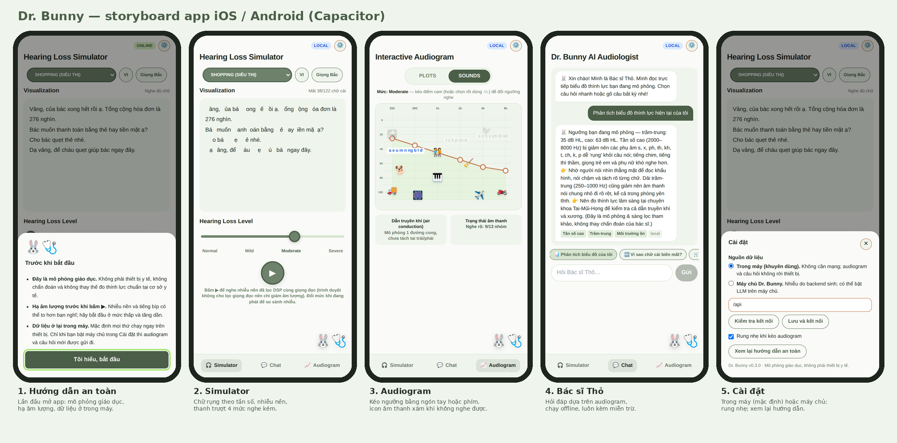
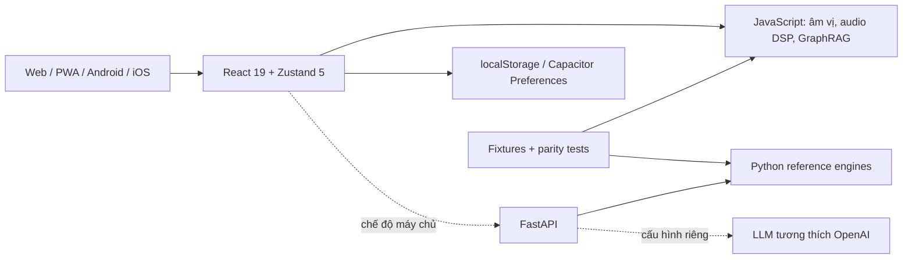

# HearAtlas

**Tiếng Việt** · [English](README.en.md) · [简体中文](README.zh-CN.md)

**Hiểu âm thanh. Kết nối trải nghiệm.** Nền tảng alpha về giáo dục thính giác, phát triển từ các demo Dr. Bunny và hoạt động cộng đồng/PTIT. Một ứng dụng React dùng chung cho web, PWA, Android và iOS; chức năng cốt lõi chạy ngay trên thiết bị, không cần máy chủ.

[](https://github.com/hdwc-151/Demo-hearing-loss/actions/workflows/ci.yml)
[](https://github.com/hdwc-151/Demo-hearing-loss/actions/workflows/mobile.yml)
[](https://github.com/hdwc-151/Demo-hearing-loss/actions/workflows/pages.yml)
[](LICENSE)

[Mở web](https://hdwc-151.github.io/Demo-hearing-loss/) · [Demo một file](https://hdwc-151.github.io/Demo-hearing-loss/demo.html) · [Tài liệu](docs/README.md) · [Mobile build](mobile/README.md) · [Rà soát PR #11](docs/maintenance/mobile-dependency-review.md)

> **Đây là mô hình giáo dục, chưa được kiểm định lâm sàng.** Không dùng để đo, chẩn đoán mất thính lực, kê đơn hay hiệu chỉnh máy trợ thính. Hạ âm lượng thiết bị trước khi nghe. Limiter số không bảo đảm áp suất âm an toàn qua tai nghe/loa.



## Tính năng và phạm vi

| Thành phần | Chức năng thực tế | Giới hạn |
| --- | --- | --- |
| Simulator | Normal/Mild/Moderate/Severe; tình huống nghe; văn bản theo nhóm âm vị, TTS và nhiễu thủ tục | Nội dung VI/EN, một số quy tắc giọng Bắc/Nam; TTS không đi qua bộ lọc audiogram |
| Audiogram Studio | Kéo hoặc dùng bàn phím chỉnh 6 tần số 250–8000 Hz; liên kết với Simulator | Mô phỏng một tai, dẫn truyền khí; không phải phép đo |
| Audio Lab | A: gốc, B: suy giảm STFT/ERB/dcGC-shaped, C: EQ/WDRC giáo dục; RMS, trọng tâm phổ, năng lượng cao tần | File ≤12 MB/8 giây; ERB/dcGC/WDRC ≤4 giây/48 kHz, chạy trên UI thread |
| Dr. Bunny | Giải thích có nguồn; truy xuất theo quy tắc và audiogram, LLM máy chủ tuỳ chọn | Chưa có trợ lý được huấn luyện riêng; biểu cảm thỏ là trạng thái UI |
| Offline và lưu cài đặt | Engine JavaScript, PWA cache, Preferences trên native, localStorage trên web | PWA cần tải thành công lần đầu; chưa đồng bộ tài khoản/cloud |
| Apple Health preview | Chủ động đọc audiogram hai tai trên iPhone, giữ trong bộ nhớ | Chỉ native iOS; không tự lưu/gửi lên máy chủ hoặc áp vào mô phỏng; cần test HealthKit máy thật |
| Android/iOS | Dự án native đã commit; build debug APK và iOS Simulator qua CI | Chưa có signed release, Play Store/TestFlight hay xác nhận trên điện thoại thật |

“Chữ rụng” minh hoạ một quy tắc, không mô tả chính xác mọi người nghe kém. dB HL không chuyển trực tiếp thành dB SPL/dBFS. dcGC-shaped là xấp xỉ biên độ phổ, chưa phải bộ lọc Gammachirp nhân quả đã kiểm định. EQ/WDRC xử lý **tín hiệu gốc** với gain tối đa +6 dB và limiter ±0,8, không phải máy trợ thính thật. Nhiễu thủ tục không phải GAN đã huấn luyện.

## Kiến trúc và thành phần



| Lớp | Thành phần | Đường dẫn |
| --- | --- | --- |
| Giao diện | React **19.3.1**, Zustand **5.0.16**, Tailwind **3.4.17**, Vite **6.4.6** | `frontend/src/`, `frontend/vite.config.js` |
| Logic trong máy | Âm vị VI/EN, nhiễu FFT, STFT/ERB/dcGC/WDRC, GraphRAG | `frontend/src/util/`, `frontend/src/data/` |
| Native | Capacitor **8.6.0** core/CLI/Android/iOS; App, Haptics, Preferences, SplashScreen, StatusBar | `frontend/src/native.js`, `storage.js`, `capacitor.config.json` |
| Tài nguyên mobile | Capacitor Assets **4.0.0**, icon/splash và listing | `mobile/`, `frontend/scripts/mobile.mjs` |
| API tuỳ chọn | Python **3.12** trong CI, FastAPI, Pydantic, NumPy, HTTPX, Uvicorn | `backend/main.py`, `backend/core/` |
| Kiểm thử | pytest, Node test, fixtures Python–JS, Playwright/Chromium, Gradle, Xcode | `tests/`, `frontend/scripts/`, `.github/workflows/` |

Kế thừa hai nguyên tắc: **offline-first, server-optional** và **Python–JavaScript parity**. `frontend/package-lock.json` khóa phiên bản thực tế; plugin có phiên bản riêng, không bắt buộc cùng số minor với core. Backend `requirements.txt` dùng cận dưới, không phải lockfile; `requirements-tested.txt` là snapshot kiểm thử cũ.

## Cấu trúc repository

```text
frontend/
  src/                 React UI, store, API, engine trong máy, HealthKit preview
  public/              manifest và service worker PWA
  android/             Gradle, manifest, MainActivity và tài nguyên Android
  ios/                 Xcode, SwiftPM, HealthKit, privacy manifest
  scripts/             test, parity, build demo và mobile
backend/               FastAPI và các engine Python tham chiếu
tests/                 pytest, fixtures, research và E2E trình duyệt
demo/index.html        demo độc lập đã commit, mở bằng file://
mobile/                hướng dẫn, icon/splash, hồ sơ cửa hàng
docs/                  kiến trúc, API, nghiên cứu, triển khai, lịch sử
scripts/               công cụ kiểm tra API và hỗ trợ repository
legacy/                prototype được giữ lại
archive/               các triển khai, tài liệu và demo lịch sử
.github/workflows/     CI, mobile, HealthKit, container và Pages
docker-compose.yml     web/nginx + backend
Makefile               lệnh tắt phát triển
REPOSITORY_MAP.md      bản đồ và nguồn gốc thư mục
```

Phát triển ứng dụng hiện hành trong `frontend/` và `backend/` ở gốc. Không chạy `Master/`, `final/`, `Hearing/` trong archive như phiên bản đang được duy trì.

## Cài và chạy web

**Dùng ngay:** tải repo, mở [`demo/index.html`](demo/index.html) trong Chrome/Edge. Không cần Node, Python hoặc API. Demo đã commit là snapshot; sau khi sửa React, dựng lại bằng `npm run build:demo`. Công cụ tự lưu snapshot trước khi ghi đè demo cũ.

**Phát triển:** Git, Node.js **22+** và npm. Từ gốc repository:

```sh
git clone https://github.com/hdwc-151/Demo-hearing-loss.git
cd Demo-hearing-loss/frontend
npm ci
npm run dev
```

Mở `http://localhost:5173`, chọn **Cài đặt → Trong máy** để dùng không cần backend. Web dev mặc định thử `/api`; Vite proxy `/api/*` đến `http://localhost:8000/*`. `npm run build` tạo `frontend/dist/`; `npm run preview` chỉ phục vụ bản build, **không có proxy API**. Web công khai cần reverse proxy hoặc API HTTPS được cấu hình riêng.

GitHub Pages dùng `VITE_BASE=/<tên-repo>/`, `VITE_API_BASE=offline`, cần Pages Source = **GitHub Actions** và workflow deploy thành công. PWA offline sau lần tải đầu. Docker: từ gốc chạy `docker compose up --build`, mở `http://localhost:8080`; nginx chuyển `/api/` tới backend.

## Máy chủ/API — tuỳ chọn

Chức năng trong máy không yêu cầu tài khoản hay khóa API. Để chạy API, tạo môi trường Python **3.12** ở gốc:

```powershell
# Windows PowerShell
py -3.12 -m venv .venv
.\.venv\Scripts\Activate.ps1
python -m pip install -r backend/requirements.txt
python -m uvicorn main:app --app-dir backend --reload --port 8000
```

```sh
# macOS / Linux
python3.12 -m venv .venv
source .venv/bin/activate
python -m pip install -r backend/requirements.txt
python -m uvicorn main:app --app-dir backend --reload --port 8000
```

Kiểm tra `http://localhost:8000/health`, Swagger tại `/docs`; hoặc `python scripts/check_backend.py http://localhost:8000`.

| Biến môi trường máy chủ | Ý nghĩa |
| --- | --- |
| `ALLOWED_ORIGINS` | Origin CORS chính xác, cách nhau bằng dấu phẩy; mặc định localhost:5173 |
| `LLM_API_KEY` | Chỉ lưu ở máy chủ; thiếu khóa thì dùng câu trả lời theo quy tắc |
| `LLM_BASE_URL`, `LLM_MODEL` | Endpoint tương thích OpenAI và tên model; mặc định trong `.env.example` |
| `LLM_TIMEOUT` | Timeout LLM, mặc định 15 giây |
| `GAN_CKPT` | Cần tự cài torch và checkpoint tương thích; chưa xác nhận GAN thật |

Sao chép `.env.example` thành `.env`, sửa giá trị, thêm `--env-file .env` vào lệnh Uvicorn ở gốc nếu cần nạp file này. Không đưa khóa vào `VITE_*` hoặc Git. API công khai cần HTTPS, giới hạn request/chi phí và giám sát tại host; CORS không phải xác thực/rate limiting. Xem [triển khai](docs/deployment.md).

| API | Mục đích |
| --- | --- |
| `GET /health`, `/scenarios`, `/sound-items`, `/presets` | Trạng thái, tình huống, mốc âm thanh và cấu hình |
| `POST /degrade` | Văn bản VI/EN theo mức giả định, tối đa 5.000 ký tự |
| `POST /graphrag` | Đủ 6 tần số, ngưỡng nguyên −10…110 dB; câu hỏi ≤500 ký tự |
| `GET /noise` | WAV minh hoạ, 0,5–10 giây, seed tuỳ chọn |

Schema và lỗi 422: [docs/api.md](docs/api.md). Khi mất máy chủ, frontend có đường lùi sang tri thức/nhiễu trong máy.

## Android và iOS bằng Capacitor

| Yêu cầu | Android | iOS |
| --- | --- | --- |
| Máy build | Windows / Linux / macOS | **macOS** |
| Công cụ | Android Studio **Otter 2025.2.1+**, **JDK 21**, SDK **36** | **Xcode 26+**, SwiftPM |
| Thiết bị tối thiểu | Android **7.0 / API 24** | iOS **15**; HealthKit cần iPhone phù hợp |
| Dùng chung | Node 22+, npm; `npm ci` trong `frontend/` | Node 22+, npm |

Yêu cầu theo [Capacitor 8](https://capacitorjs.com/docs/updating/8-0). Dự án native đã có sẵn: **không chạy lại `cap add`**.

```sh
# Từ frontend/
npm run android             # build web → sync Android → mở Android Studio
npm run android:run         # build → sync → chọn emulator/thiết bị và chạy
npm run android:debug       # build → sync → Gradle assembleDebug
npm run android:test        # build → sync → unit tests và Android lint
npm run ios                 # macOS: build → sync iOS → mở Xcode
npm run ios:run             # macOS: chọn Simulator/thiết bị; máy thật cần signing
npm run ios:debug           # macOS: biên dịch iOS Simulator, không ký
npm run cap:sync -- android # chỉ build và đồng bộ Android
npm run cap:sync -- ios     # macOS: chỉ build và đồng bộ iOS
```

`build:mobile` luôn dùng asset base `/`, API `offline`, tắt chế độ demo; không lấy tiền tố Pages hoặc API từ lần build web. `cap:sync` cần chỉ rõ nền tảng. Sau khi sửa React, chạy lại lệnh mobile. APK: `frontend/android/app/build/outputs/apk/debug/app-debug.apk`; Simulator app: `frontend/ios/DerivedData/Build/Products/Debug-iphonesimulator/App.app`.

Mobile khởi động ở **Trong máy**. Để dùng API, nhập **URL HTTPS đầy đủ** trong Cài đặt, không dùng `/api` hoặc `localhost` của điện thoại. Backend thêm origin `https://localhost` (Android), `capacitor://localhost` (iOS) vào `ALLOWED_ORIGINS`. Vite proxy chỉ có ở web dev. Không bật HTTP/mixed content hoặc tắt ATS cho release; API cục bộ cần HTTPS có chứng chỉ được thiết bị tin cậy. Hướng dẫn kết nối, signing, cài APK/Simulator và checklist máy thật: [mobile/README.md](mobile/README.md).

Application ID vẫn là `app.drbunny.simulator` để giữ tương thích. HearAtlas là tên làm việc chưa xác nhận nhãn hiệu/miền/cửa hàng; không đổi storage keys, ID hoặc dữ liệu lịch sử khi chỉ đổi thương hiệu.

## Kiểm thử, CI và Dependabot

```sh
# Từ gốc, sau khi cài backend
python -m pytest tests -q
python tests/eval_retrieval.py
cd frontend
npm test
npm run test:mobile
npm run build
npm audit --omit=dev --audit-level=high
npm audit --audit-level=high
```

E2E cần `python -m pip install playwright pillow`, `python -m playwright install chromium`, backend :8000 và Vite :5173. Từ gốc chạy các script `python tests/e2e_browser.py`, `python tests/e2e_review.py`, `python tests/e2e_mobile.py`, `python tests/e2e_audio_lab.py`. Demo: `python tests/e2e_demo.py`; PWA cần build và preview :4173 trước `python tests/e2e_pwa.py`. Xem [kiểm thử](docs/testing.md).

CI chạy backend, nghiên cứu số học, frontend/parity, Chromium E2E, demo/PWA; workflow mobile tạo APK debug, chạy unit/lint, biên dịch và đóng gói iOS Simulator. Đây **không thay thế thử âm thanh, rung, VoiceOver/TalkBack, cuộc gọi/khóa màn hình, HealthKit trên máy thật**. APK debug dùng khóa test; Simulator app không cài lên iPhone/TestFlight.

Dependabot ở `.github/dependabot.yml` nhóm `@capacitor/*`, nên PR #11 có 5 cập nhật là bảo trì bình thường. Nhánh này kiểm thử Capacitor 8.6/Assets 4 cùng bản vá Vite 6.4.6; không merge/đóng PR #11 tự động. [Báo cáo rà soát](docs/maintenance/mobile-dependency-review.md) ghi commit, CI, audit và phần chưa xác minh. CI quét runtime và công cụ build với ngưỡng high. Cảnh báo moderate còn lại được ghi nhận, không coi là đã hết; số lượng có thể đổi theo advisory.

## Giá trị kế thừa và giới hạn phát hành

- Giữ audiogram tương tác, âm vị tiếng Việt, offline, demo một file và parity Python–JS từ Dr. Bunny.
- Giữ `archive/`, hai demo lịch sử có kiểm tra SHA, `legacy/`, repo/URL và storage keys. [README trước thay đổi](docs/history/README_before_mobile_multilingual.md) lưu toàn bộ nội dung cũ; [README v0.2](docs/history/README_fullstack_v0.2.md), [bản đồ repo](REPOSITORY_MAP.md) giữ nguồn gốc.
- Parity và kiểm thử số học chưa chứng minh giá trị lâm sàng/chất lượng nghe thực. Holdout GraphRAG từng dùng khi tinh chỉnh, không phải đánh giá độc lập.
- Chưa có signed AAB/IPA, TestFlight/Play internal test, HealthKit máy thật, checkpoint GAN hoặc xác nhận LLM provider thật. Xem [gate phát hành](docs/product/DEPLOYMENT_READINESS.md).

[Kiến trúc](docs/architecture.md) · [Audio Foundation](docs/audio-foundation.md) · [Kiểm chứng số học](docs/science/NUMERICAL_REFERENCE_VALIDATION.md) · [Nguồn y khoa](docs/clinical/HEARING_EVIDENCE.md) · [Apple Health](docs/product/APPLE_HEALTHKIT_IOS.md) · [Kế hoạch sản phẩm](docs/product/HEARATLAS_PRODUCT_ALPHA.md) · [Nghiên cứu trợ lý](docs/research/ASSISTANT_TRAINING_AND_SCENARIOS.md) · [Kiểm kê archive](docs/research/ARCHIVE_DISTILLATION.md) · [Đóng góp](CONTRIBUTING.md) · [Bảo mật](SECURITY.md) · [MIT](LICENSE).

Lựa chọn ngôn ngữ README chỉ đổi tài liệu; không bổ sung giao diện tiếng Trung cho app.
