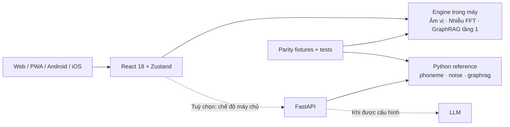

<div align="center">

# HearAtlas
### Hiểu âm thanh. Kết nối trải nghiệm.

**Product Alpha · Audiogram Studio · Audio Lab · Everyday Listening · Dr. Bunny**

Một mã nguồn React cho **Web, PWA và dự án ứng dụng Android/iOS**; các chức năng cốt lõi có thể chạy **không cần máy chủ**.

[](https://github.com/hdwc-151/Demo-hearing-loss/actions/workflows/ci.yml)
[](https://github.com/hdwc-151/Demo-hearing-loss/actions/workflows/pages.yml)

[](LICENSE)

**[Mở HearAtlas trên web](https://hdwc-151.github.io/Demo-hearing-loss/)** · **[Bản offline một file](https://hdwc-151.github.io/Demo-hearing-loss/demo.html)** · [Hướng dẫn cài đặt](#-chạy-trên-máy-tính) · [Tài liệu kỹ thuật](docs/README.md)


</div>

> [!IMPORTANT]
> **HearAtlas đang ở giai đoạn sản phẩm alpha về giáo dục thính giác, không phải thiết bị y tế được kiểm định.** Các hiệu ứng chữ, âm thanh và ngưỡng nghe là mô hình minh hoạ, **không phải phép đo hay chẩn đoán mất thính lực**. Không dùng ứng dụng để tự kết luận tình trạng sức khoẻ, thay thế khám thính học hoặc hiệu chỉnh máy trợ thính. Hãy giữ âm lượng phát ở mức an toàn.
>
> Các liên kết GitHub Pages hoạt động sau khi workflow triển khai thành công và Pages được cấu hình dùng **GitHub Actions**. Không cần chờ Pages để dùng bản `demo/index.html` có sẵn trong repo.

> **Chuyển đổi thương hiệu:** `HearAtlas` là tên làm việc trong giai đoạn alpha, chưa xác nhận nhãn hiệu/miền/App Store. Repo GitHub, URL Pages, storage keys, native application ID, các tệp archive và một số API legacy tiếp tục giữ tên cũ để bảo vệ tương thích. Các tài liệu lịch sử có thể vẫn dùng tên `Dr. Bunny`. Đây không phải tuyên bố ứng dụng đã được thẩm định lâm sàng. [Kế hoạch sản phẩm](docs/product/HEARATLAS_PRODUCT_ALPHA.md) · [Kiểm kê archive](docs/research/ARCHIVE_DISTILLATION.md) · [Lộ trình trợ lý](docs/research/ASSISTANT_TRAINING_AND_SCENARIOS.md).

**Tên thương hiệu:** HearAtlas là nền tảng; **Dr. Bunny** là nhân vật trợ lý giải thích có trích dẫn trong ứng dụng. Trạng thái cảm xúc là biểu cảm UI, không phải cảm xúc người dùng được AI suy luận. Tham khảo [nguồn y khoa](docs/clinical/HEARING_EVIDENCE.md) và [HealthKit iOS](docs/product/APPLE_HEALTHKIT_IOS.md).

## HearAtlas giải quyết vấn đề gì?

Một con số trên biểu đồ thính lực khó diễn tả được người nghe có thể bỏ lỡ **âm tiết nào, dấu hiệu âm thanh nào, hoặc câu nói nào** trong môi trường ồn. HearAtlas giúp giải thích các đường ngưỡng nghe giả định qua trải nghiệm có thể tương tác để phục vụ học tập và truyền thông nhận thức.

Bạn có thể đổi một đường audiogram, xem phần văn bản bị suy giảm theo quy tắc âm vị, bật thử nhiễu nền và đặt câu hỏi cho “Dr. Bunny”. Mục tiêu là **giải thích một mô hình**, không tái tạo chính xác cảm nhận âm thanh của một cá nhân.

## Audio Lab — STFT, ERB, dcGC thử nghiệm và EQ/WDRC

Audio Lab chạy offline, xử lý trực tiếp file âm thanh trên thiết bị. Chọn một trong ba đường nghe:

- **A — Gốc:** nghe audio chưa qua xử lý.
- **B — Suy giảm thính giác minh hoạ:** chọn STFT tuyến tính, ERB 12 dải hoặc **dcGC-shaped** (Gammachirp bất đối xứng có tham số điều khiển theo mức). Bộ dcGC hiện mới xử lý **biên độ phổ** và sử dụng HP bất đối xứng kiểu xấp xỉ, **chưa phải bộ lọc Gammachirp nhân quả/được thẩm định lâm sàng**.
- **C — Bù nghe EQ/WDRC giáo dục:** bộ nén dải động nhiều dải độc lập trên **tín hiệu gốc**; tối đa +6 dB gain số và limiter số ±0,8. Không được hiểu là thông số kê đơn hoặc máy trợ thính thật.

Ngoài phát A/B/C, ứng dụng hiển thị RMS số, trọng tâm phổ và tỷ lệ năng lượng từ 4 kHz trở lên để quan sát sự khác biệt. File nạp tối đa 8 giây và 12 MB; các bộ lọc thực nghiệm ERB/dcGC/WDRC giới hạn 4 giây và 48 kHz vì còn tính toán trên UI thread.

**Cảnh báo:** dB HL trong audiogram không được chuyển trực tiếp thành dB SPL hay dBFS. Limiter và nút âm lượng phần mềm **không** bảo đảm mức áp suất âm an toàn qua loa/tai nghe. Hạ âm lượng thực tế trước khi nghe, không sử dụng ứng dụng để chẩn đoán hoặc thay thiết bị trợ thính chuyên dụng.

**Kiểm thử:** Python/JavaScript unit tests, 12 bộ dữ liệu waveform dcGC/WDRC đối chiếu chéo, Chromium E2E và giới hạn thuật toán; tài liệu khoa học tại [Audio Foundation](docs/audio-foundation.md), [Numerical Reference Validation](docs/science/NUMERICAL_REFERENCE_VALIDATION.md) và [Research gate](https://github.com/hdwc-151/Demo-hearing-loss/issues/25). Các kiểm chứng số học **không đồng nghĩa** với mô hình cảm nhận nghe kém được kiểm nghiệm trên người.

**Lưu trữ:** hai bản HTML lịch sử có SHA bất biến trong [archive/demos/](archive/demos/README.md); mỗi lần ghi đè bản demo cũ cần tạo snapshot SHA-256 trước. Các triển khai và dữ liệu cũ khác tiếp tục được giữ trong `archive/`.

## Tính năng đang có trong Product Alpha

| Thành phần | Bạn có thể làm gì? | Phạm vi hiện tại |
| --- | --- | --- |
| **Simulator** | Thử 4 mức **Normal / Mild / Moderate / Severe**, các tình huống âm thanh; quan sát văn bản bị ẩn theo dải âm vị, phát giọng đọc và nhiễu minh hoạ. | Tiếng Việt, tiếng Anh; phân biệt quy tắc giọng Bắc/Nam đối với một số âm vị. |
| **Audiogram** | Kéo các điểm ngưỡng tại **6 tần số**, dùng bàn phím để điều chỉnh và xem các biểu tượng âm thanh đổi trạng thái. | Mô phỏng một tai bằng dẫn truyền khí; thay đổi đường ngưỡng có tác động trở lại Simulator. |
| **Dr. Bunny** | Trợ lý kiến thức thính giác, giải thích biểu đồ giả định và tình huống giao tiếp; chưa có chức năng chẩn đoán. | Bộ truy xuất tri thức có quy tắc (**GraphRAG tầng 1**, 6 nút); LLM phía máy chủ là tuỳ chọn, không phải điều kiện sử dụng. |
| **Offline-first** | Dùng các engine văn bản, GraphRAG và nhiễu thủ tục ngay trên thiết bị; lưu cài đặt. | Web/PWA không cần backend ở chế độ **Trong máy**; backend FastAPI bổ sung API, nhiễu WAV và tuỳ chọn LLM. |
| **Đa nền tảng** | Chạy web, cài PWA, mở dự án Android/iOS bằng Capacitor. | Dự án native đã được tạo; **chưa xác nhận build native hoặc thử trên điện thoại thật**. |

**Lưu ý:** “Chữ rụng” chỉ là quy tắc minh hoạ theo nhóm âm vị và ngưỡng giả định; không có nghĩa người nghe kém thực tế chỉ mất đúng các ký tự đó. Giọng đọc từ Web Speech API hiện **không đi qua bộ lọc thính lực**. Nhiễu thủ tục không phải GAN đã huấn luyện.

## 🧱 Kiến trúc đang sử dụng



Frontend sử dụng **React 18, Vite 5, Tailwind CSS 3 và Zustand 4**. Backend sử dụng **Python 3.12, FastAPI** và các mô-đun xử lý tín hiệu. **Capacitor 8** chia sẻ mã nguồn web với dự án Android/iOS.

Thiết kế có hai nguyên tắc:

1. **Offline-first, server-optional:** hoạt động cốt lõi không phụ thuộc kết nối mạng; khi bật chế độ máy chủ mà API lỗi, ứng dụng chuyển sang logic trong máy.
2. **Python–JavaScript parity:** `backend/core/` là bản tham chiếu; `frontend/src/util/` được đối chiếu với fixture để phát hiện sai khác khi sửa thuật toán. Kiểm thử parity không chứng minh độ chính xác lâm sàng.

Xem [kiến trúc chi tiết](docs/architecture.md), [engine offline](docs/offline-engines.md) và [các quyết định thiết kế](docs/adr/).

## 📁 Cấu trúc repository

```text
Demo-hearing-loss/
├── frontend/               React, Vite, PWA, Capacitor
│   ├── src/                UI, store, API, engine chạy trong máy
│   ├── public/             manifest, service worker, biểu tượng
│   ├── android/            Dự án Android (native)
│   ├── ios/                Dự án iOS (native)
│   └── scripts/            parity, logic tests, build demo
├── backend/                FastAPI và Python reference engines
├── tests/                  pytest, fixture, Chromium E2E, PWA
├── demo/index.html         Bản HTML độc lập dùng được bằng file://
├── mobile/                 Tài nguyên, hướng dẫn build và store listing
├── docs/                   API, kiến trúc, triển khai, kiểm thử, thiết kế
├── scripts/                Công cụ hỗ trợ dự án
├── legacy/                 Prototype của bản ứng dụng hiện tại
├── archive/                Code, tài liệu và các phiên bản cũ được bảo toàn
├── .github/workflows/      CI, GitHub Pages, workflow mobile
├── docker-compose.yml      Backend + web qua Docker
├── Makefile                Lệnh tắt cho người phát triển
└── REPOSITORY_MAP.md       Bản đồ repo sau khi tái cấu trúc
```

**Phát triển phiên bản đang được duy trì tại thư mục gốc.** Không lấy `Master/`, `final/`, `Hearing/` hoặc code trong `archive/` làm entry point hiện hành. Chi tiết nguồn gốc nằm trong [REPOSITORY_MAP.md](REPOSITORY_MAP.md).

## 🚀 Chạy trên máy tính

### Cách nhanh nhất — không cần Python hay cài thư viện

Tải repository về và mở **`demo/index.html`** trong Chrome/Edge hoặc một trình duyệt hiện đại. Đây là bản một file chạy bằng `file://`, không yêu cầu backend. Để cập nhật bản demo sau khi sửa mã React, dùng `npm run build:demo` trong `frontend/`.

### Cách dành cho người phát triển — Windows / macOS / Linux

**Yêu cầu:** Python **3.12**, Node.js **22 trở lên** (kèm npm), Git. Nên dùng terminal trong VS Code. Lệnh phía dưới chạy từ **thư mục gốc repository**, trừ khi có chú thích.

**Bước 1 — lấy mã nguồn**

```bash
git clone https://github.com/hdwc-151/Demo-hearing-loss.git
cd Demo-hearing-loss
```

**Bước 2 — cài frontend và khởi chạy giao diện**

```bash
cd frontend
npm ci
npm run dev
```

Mở **http://localhost:5173**. Chọn **Cài đặt → Trong máy** để dùng ứng dụng không cần backend. Nếu chỉ cần thử giao diện và engine offline, có thể dừng ở đây.

**Bước 3 — chạy backend (tuỳ chọn; mở terminal thứ hai)**

Windows (PowerShell):

```powershell
py -3.12 -m venv .venv
.\.venv\Scripts\Activate.ps1
python -m pip install -r backend/requirements.txt
cd backend
python -m uvicorn main:app --reload --port 8000
```

macOS / Linux:

```bash
python3.12 -m venv .venv
source .venv/bin/activate
python -m pip install -r backend/requirements.txt
cd backend
python -m uvicorn main:app --reload --port 8000
```

API tại **http://localhost:8000**, tài liệu Swagger tại **http://localhost:8000/docs**. Frontend ở `localhost:5173` có proxy **`/api` → `localhost:8000`** trong môi trường Vite dev.

> Với người dùng `make` (macOS/Linux, hoặc Windows đã cài Make), có thể dùng `make install`, `make dev-api`, `make dev-web`. Mỗi server chạy ở một terminal. Lệnh `make install` sử dụng `backend/requirements-tested.txt`.

**Dùng Docker (backend + web):**

```bash
docker compose up --build
```

Sau khi khởi động, mở **http://localhost:8080**. Chi tiết cấu hình môi trường, CORS và triển khai: [docs/deployment.md](docs/deployment.md).

## ✅ Kiểm thử và mức độ xác nhận

CI chạy tự động khi tạo PR hoặc push lên `main`: **backend → frontend → Chromium E2E**. Bản tái cấu trúc đã vượt qua [workflow CI ngày 04/11/2026](https://github.com/hdwc-151/Demo-hearing-loss/actions/runs/41795499375).

| Lớp | Lệnh hoặc quy trình | Kết quả CI đã ghi nhận |
| --- | --- | --- |
| Backend & API | `python -m pytest tests -q` | **49 passed**, 1 warning |
| Đánh giá GraphRAG | `python tests/eval_retrieval.py` | Dev **12/12**, holdout **8/8** |
| Parity & logic frontend | `cd frontend && npm test` | **111** ca chữ, **8** nhóm hằng số, **87** ca GraphRAG, **20** test logic |
| Frontend production | `cd frontend && npm run build` | **Passed** |
| Kiểm tra dependency runtime | `cd frontend && npm audit --omit=dev --audit-level=high` | **Passed** |
| Browser E2E (Chromium) | `tests/e2e_browser.py`, `e2e_review.py`, `e2e_mobile.py` | **16 + 17 + 13 = 46/46** |
| Demo HTML độc lập | `tests/e2e_demo.py` | **8/8** |
| PWA offline | `tests/e2e_pwa.py` | **5/5** |

Để chạy lại các bài kiểm tra nhanh sau khi cài phụ thuộc:

```bash
python -m pytest tests -q
python tests/eval_retrieval.py
cd frontend
npm test
npm run build
```

E2E cần Python Playwright + Chromium, backend và frontend dev đang chạy; xem **[hướng dẫn kiểm thử](docs/testing.md)** và workflow [`ci.yml`](.github/workflows/ci.yml) để lặp lại đúng điều kiện CI.

**Giới hạn của kết quả trên:** holdout GraphRAG đã từng được dùng trong quá trình tinh chỉnh, vì vậy **không phải kiểm chứng độc lập về khả năng tổng quát hoá**. E2E mobile hiện mô phỏng viewport và hành vi trình duyệt; **không phải bài test trên điện thoại Android/iOS thật**.

## 🌐 Deploy web, PWA và mobile

| Đích | Cách triển khai | Tình trạng |
| --- | --- | --- |
| **GitHub Pages** | Workflow [`pages.yml`](.github/workflows/pages.yml) build ứng dụng với `VITE_API_BASE=offline` và base theo tên repo. | Cần workflow deploy thành công và Pages được cấu hình đúng. |
| **Demo HTML độc lập** | `cd frontend && npm run build:demo`, file đầu ra mặc định là `demo/index.html`. | Đã vượt Chromium E2E với `file://`. |
| **Docker** | `docker compose up --build` | Đã có cấu hình; theo dõi [hướng dẫn triển khai](docs/deployment.md) trước khi mở công khai. |
| **Android/iOS** | `cd frontend && npm run android` hoặc `npm run ios` (iOS cần macOS/Xcode). | Dự án native có sẵn; chưa xác nhận biên dịch, signing, TestFlight hay Play Store. |

Nếu GitHub Pages chưa được kích hoạt, vào **Settings → Pages → Build and deployment → Source: GitHub Actions**. Trang chính dự kiến tại `https://hdwc-151.github.io/Demo-hearing-loss/`; bản một file sau deploy tại `/demo.html`.

## 🔌 API (khi bật backend)

| Endpoint | Phương thức | Mục đích |
| --- | --- | --- |
| `/health` | GET | Trạng thái API |
| `/scenarios` | GET | Danh sách tình huống |
| `/sound-items` | GET | Mốc âm thanh cho audiogram |
| `/presets` | GET | Ngưỡng và hằng số tham chiếu |
| `/degrade` | POST | Minh hoạ suy giảm văn bản |
| `/graphrag` | POST | Truy xuất và diễn giải theo audiogram |
| `/noise` | GET | Tạo WAV nhiễu minh hoạ |

Chi tiết tham số, giới hạn đầu vào và ví dụ: [docs/api.md](docs/api.md).

## ⚠️ Những gì dự án **chưa** khẳng định

- **Chưa có hiệu chuẩn lâm sàng:** ngưỡng, độ suy giảm âm vị, nhiễu, speech banana và biểu tượng âm thanh là xấp xỉ để minh hoạ. Cần chuyên gia thính học, dữ liệu và thí nghiệm người nghe để đánh giá tính thực.
- **Chưa lọc giọng nói TTS theo audiogram:** `speechSynthesis` không cung cấp luồng PCM cho pipeline DSP hiện tại.
- **Không coi GAN/LLM là đã xác nhận production:** có tầng dự phòng và test bằng mock, nhưng chưa kiểm chứng checkpoint GAN hay nhà cung cấp LLM thật trong CI.
- **Chưa xác nhận native release:** bài kiểm thử viewport mobile không thay thế build và kiểm thử Android/iOS thật.
- **Bảo mật vận hành cần bổ sung trước khi public API:** HTTPS, quản lý secret và rate limiting cho endpoint LLM; xem [deployment checklist](docs/deployment.md).

Mô tả phương pháp và hạn chế kỹ thuật: [docs/architecture.md](docs/architecture.md), [docs/testing.md](docs/testing.md).

## 📚 Tài liệu và đóng góp

**Bắt đầu từ:** [Mục lục tài liệu](docs/README.md) · [Kiến trúc](docs/architecture.md) · [Thiết kế mobile](docs/mobile-app-design.md) · [Mobile build](mobile/README.md) · [Triển khai](docs/deployment.md) · [Bản đồ repo](REPOSITORY_MAP.md).

Đóng góp và đề xuất cải tiến theo [CONTRIBUTING.md](CONTRIBUTING.md). Báo vấn đề bảo mật theo [SECURITY.md](SECURITY.md), không công khai secret hoặc dữ liệu nhạy cảm trong issue. Dự án phát hành theo [MIT License](LICENSE).

---

## English overview

**HearAtlas product alpha** is an **educational hearing-experience platform**, not a medical diagnostic or assistive-hearing device. It combines a six-frequency audiogram, rule-based phoneme/text degradation, illustrative background noise, and an audiogram-aware question-answering assistant.

The maintained codebase uses **React/Vite/Zustand**, **FastAPI/Python**, and **Capacitor 8**. Core functions run **offline** on the client; the server is optional. GitHub CI has passed backend, frontend build, JavaScript–Python parity, Chromium E2E, standalone HTML demo, and offline-PWA tests. **Native Android/iOS builds, clinical validation, real GAN checkpoints, and production LLM integration remain unverified.**

**Get started:** open [`demo/index.html`](demo/index.html) directly, or install the frontend with `cd frontend && npm ci && npm run dev`. See [technical documentation](docs/README.md) for architecture, testing and deployment.
