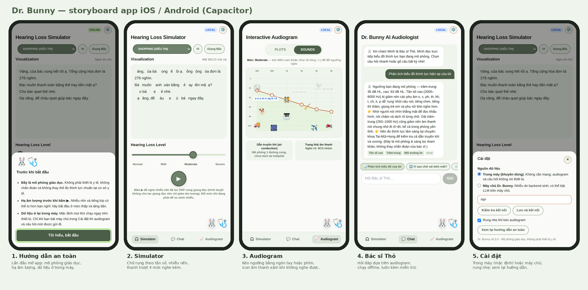
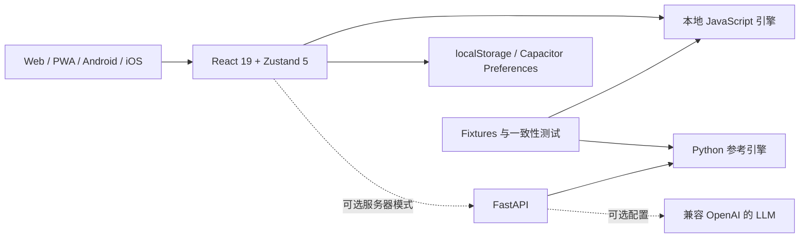

# HearAtlas

[Tiếng Việt — 默认](README.md) · [English](README.en.md) · **简体中文**

**理解声音，连接体验。** 这是一个听觉教育产品的 alpha 版本，源于 Dr. Bunny 演示及社区/PTIT 项目。通过同一套 React 代码支持 Web、PWA、Android 和 iOS；核心功能在设备上运行，无需服务器。

[打开 Web 应用](https://hdwc-151.github.io/Demo-hearing-loss/) · [单文件演示](https://hdwc-151.github.io/Demo-hearing-loss/demo.html) · [文档](docs/README.md) · [移动端指南](mobile/README.md) · [依赖审查](docs/maintenance/mobile-dependency-review.md)

> **本项目仅用于教育模拟，尚未经过临床验证。** 不可用于听力测量、诊断、处方或助听器验配。试听前请降低设备音量。数字限幅器不能保证耳机或扬声器的实际声压安全。



## 功能与范围

| 组件 | 已实现功能 | 限制 |
| --- | --- | --- |
| Simulator | Normal/Mild/Moderate/Severe 预设、听音场景、音素分组文字演示、TTS 和程序噪声 | 越南语/英语内容，部分越南语南北方规则；TTS 不经过听力图滤波 |
| Audiogram Studio | 拖动或使用键盘调整 250–8000 Hz 的六个阈值，并联动 Simulator | 单耳气导模拟，不是真实听力测量 |
| Audio Lab | A 原始音频、B STFT/ERB/dcGC-shaped 衰减演示、C 教育性 EQ/WDRC；显示 RMS、频谱重心和高频能量 | 文件 ≤12 MB/8 秒；ERB/dcGC/WDRC ≤4 秒/48 kHz，计算在 UI 线程运行 |
| Dr. Bunny | 带来源的解释、基于规则和听力图的知识检索、可选服务器 LLM | 尚无单独训练的助手模型；兔子表情只是 UI 状态 |
| 离线与设置 | JavaScript 引擎、PWA 缓存、原生 Preferences、浏览器 localStorage | PWA 首次需要成功加载；没有账号或云同步 |
| Apple Health 预览 | 用户主动读取 iPhone 双耳听力图，仅保留在内存中 | 仅原生 iOS；不会自动保存、上传或应用到模拟；仍需 HealthKit 真机验证 |
| Android/iOS | 已提交原生工程，CI 构建 Android debug APK 和 iOS Simulator 应用 | 尚无签名发行版、商店发布或真机验收证据 |

隐藏文字仅演示规则，不等于某个人实际的听觉体验。dB HL 不能直接换算成 dB SPL/dBFS。dcGC-shaped 近似频谱幅度，并非经过验证的因果 Gammachirp 滤波器。EQ/WDRC 处理**原始信号**，数字增益最多 +6 dB，限幅为 ±0.8，不能代替助听器。程序噪声不是已训练的 GAN。

## 架构与组件



| 层次 | 组件 | 路径 |
| --- | --- | --- |
| 界面与构建 | React 19.3.1、Zustand 5.0.16、Tailwind 3.4.17、Vite 6.4.6 | `frontend/src/`、`frontend/vite.config.js` |
| 本地逻辑 | 越/英音素、FFT 噪声、STFT/ERB/dcGC/WDRC、GraphRAG | `frontend/src/util/`、`frontend/src/data/` |
| 原生桥接 | Capacitor 8.6.0 core/CLI/Android/iOS；App、Haptics、Preferences、SplashScreen、StatusBar | `frontend/src/native.js`、`storage.js`、`capacitor.config.json` |
| 移动资源 | Capacitor Assets 4.0.0、图标、启动图和商店资料 | `mobile/`、`frontend/scripts/mobile.mjs` |
| 可选 API | CI 使用 Python 3.12；FastAPI、Pydantic、NumPy、HTTPX、Uvicorn | `backend/main.py`、`backend/core/` |
| 测试 | pytest、Node test、Python–JS fixtures、Playwright/Chromium、Gradle、Xcode | `tests/`、`frontend/scripts/`、`.github/workflows/` |

继承的原则是**离线优先、服务器可选**及 **Python–JavaScript 结果一致性**。实际前端版本以 `frontend/package-lock.json` 为准；原生插件可有独立的次版本。`backend/requirements.txt` 只有最低版本约束，不是锁文件；`requirements-tested.txt` 是较早的测试环境快照。

## 仓库结构

```text
frontend/src/         UI、状态、API、本地引擎、HealthKit 预览
frontend/public/      PWA manifest 与 service worker
frontend/android/     Gradle、manifest、MainActivity、Android 资源
frontend/ios/         Xcode、SwiftPM、HealthKit 桥接、隐私清单
frontend/scripts/     测试、结果一致性、演示及移动端构建
backend/              FastAPI 和 Python 参考引擎
tests/                pytest、fixtures、研究及浏览器 E2E
demo/index.html       已提交的独立 file:// 演示
mobile/               构建指南、图标/启动图、商店资料
docs/                 架构、API、研究、部署及历史
scripts/              API 检查和仓库辅助工具
legacy/               保留的原型
archive/              历史代码、文档和演示
.github/workflows/    CI、移动端、HealthKit、容器及 Pages
docker-compose.yml    nginx/Web 与后端
Makefile              开发快捷命令
REPOSITORY_MAP.md     目录来源说明
```

当前应用应在根目录的 `frontend/` 和 `backend/` 中开发。归档的 `Master/`、`final/`、`Hearing/` 仅作为历史参考。

## 安装并运行 Web

直接体验：下载仓库，在 Chrome/Edge 中打开 [`demo/index.html`](demo/index.html)，无需 Node、Python 或 API。这是已提交的快照。修改 React 后可运行 `npm run build:demo`，工具会在覆盖旧演示前保存快照。

开发环境需要 Git、Node.js **22+** 和 npm：

```sh
git clone https://github.com/hdwc-151/Demo-hearing-loss.git
cd Demo-hearing-loss/frontend
npm ci
npm run dev
```

打开 `http://localhost:5173`，选择 **Cài đặt → Trong máy**（设置 → 本地）可不使用后端。Web 开发默认尝试 `/api`；Vite 将 `/api/*` 代理至 `http://localhost:8000/*`。`npm run build` 生成 `frontend/dist/`；`npm run preview` **不提供 API 代理**。公开 Web 部署需配置反向代理或 HTTPS API。

Pages 使用 `VITE_BASE=/<仓库名>/` 与 `VITE_API_BASE=offline`。将 Pages Source 设置为 **GitHub Actions**，并确认部署成功。PWA 需首次加载成功后才能离线使用。也可从仓库根目录运行 `docker compose up --build`，打开 `http://localhost:8080`；nginx 会将 `/api/` 转发到后端。

## 可选服务器/API

本地功能无需账号或 API key。API 建议使用 Python **3.12**，从仓库根目录运行：

```powershell
# Windows PowerShell
py -3.12 -m venv .venv
.\.venv\Scripts\Activate.ps1
python -m pip install -r backend/requirements.txt
python -m uvicorn main:app --app-dir backend --reload --port 8000
```

```sh
# macOS / Linux
python3.12 -m venv .venv
source .venv/bin/activate
python -m pip install -r backend/requirements.txt
python -m uvicorn main:app --app-dir backend --reload --port 8000
```

检查 `http://localhost:8000/health`，Swagger 在 `/docs`；或运行 `python scripts/check_backend.py http://localhost:8000`。

| 服务器变量 | 用途 |
| --- | --- |
| `ALLOWED_ORIGINS` | 逗号分隔的准确 CORS origin，默认 localhost:5173 |
| `LLM_API_KEY` | 仅存服务器；无密钥时使用规则回答 |
| `LLM_BASE_URL`、`LLM_MODEL` | 兼容 OpenAI 的服务地址与模型名；默认值见 `.env.example` |
| `LLM_TIMEOUT` | LLM 超时，默认 15 秒 |
| `GAN_CKPT` | 需另装 torch 并提供兼容 checkpoint；真实 GAN 尚未验证 |

将 `.env.example` 复制为 `.env`，修改后在根目录 Uvicorn 命令中添加 `--env-file .env` 来加载。不要将密钥放入 `VITE_*` 或 Git。公开 API 需要 HTTPS、主机侧请求/费用限制及监控；CORS 不能代替认证或限流。参见[部署指南](docs/deployment.md)。

| API | 用途 |
| --- | --- |
| `GET /health`、`/scenarios`、`/sound-items`、`/presets` | 状态、场景、声音标记和配置 |
| `POST /degrade` | 越/英文字演示，最多 5,000 字符 |
| `POST /graphrag` | 六个指定频率，整数阈值 −10…110 dB；问题 ≤500 字符 |
| `GET /noise` | 0.5–10 秒演示 WAV，可指定 seed |

[API schema 与 422 错误](docs/api.md)。服务器不可用时，前端会回退到本地知识和噪声引擎。

## 使用 Capacitor 运行 Android/iOS

| 要求 | Android | iOS |
| --- | --- | --- |
| 构建主机 | Windows / Linux / macOS | **macOS** |
| 工具 | Android Studio **Otter 2025.2.1+**、**JDK 21**、SDK **36** | **Xcode 26+**、SwiftPM |
| 最低系统 | Android **7.0 / API 24** | iOS **15**，HealthKit 需兼容 iPhone |
| 共同要求 | Node 22+、npm，在 `frontend/` 中运行 `npm ci` | Node 22+、npm |

参见 [Capacitor 8 要求](https://capacitorjs.com/docs/updating/8-0)。原生工程已存在，**不要重新执行 `cap add`**。

```sh
# 在 frontend/ 中
npm run android             # 构建 → 同步 Android → 打开 Android Studio
npm run android:run         # 构建 → 同步 → 选择模拟器/设备运行
npm run android:debug       # 构建 → 同步 → assembleDebug
npm run android:test        # 构建 → 同步 → 单元测试及 Android lint
npm run ios                 # macOS：构建 → 同步 iOS → Xcode
npm run ios:run             # macOS：选择 Simulator/设备，真机需要签名
npm run ios:debug           # macOS：无签名 iOS Simulator 编译
npm run cap:sync -- android # 只构建并同步 Android
npm run cap:sync -- ios     # macOS：只构建并同步 iOS
```

`build:mobile` 强制使用资源基路径 `/`、API `offline` 并关闭 demo 模式，避免继承 Web/Pages 的前缀或 API。`cap:sync` 必须指定平台。修改 React 后重新运行相应移动端命令。APK：`frontend/android/app/build/outputs/apk/debug/app-debug.apk`；Simulator 应用：`frontend/ios/DerivedData/Build/Products/Debug-iphonesimulator/App.app`。

原生应用默认本地模式。服务器模式需在设置中输入**完整 HTTPS API URL**；手机的 `/api` 或 `localhost` 不指向开发电脑。后端 `ALLOWED_ORIGINS` 应加入 Android 的 `https://localhost` 与 iOS 的 `capacitor://localhost`。Vite 代理仅用于 Web 开发。测试本地 API 时使用设备信任的 HTTPS，不要在发行版中允许明文 HTTP、mixed content 或禁用 ATS。[移动端指南](mobile/README.md)包含安装、网络、签名和真机验收。

为保持兼容，application ID 仍是 `app.drbunny.simulator`。HearAtlas 是尚未确认商标/域名/商店可用性的工作名称；品牌调整不应更改存储键、ID 或历史数据。

## 测试、CI 与 Dependabot

```sh
# 仓库根目录，已安装后端依赖
python -m pytest tests -q
python tests/eval_retrieval.py
cd frontend
npm test
npm run test:mobile
npm run build
npm audit --omit=dev --audit-level=high
npm audit --audit-level=high
```

E2E：用 Python 安装 `playwright pillow`，执行 `python -m playwright install chromium`。启动 :8000 后端与 :5173 Vite，再从根目录运行 `python tests/e2e_browser.py`、`python tests/e2e_review.py`、`python tests/e2e_mobile.py`、`python tests/e2e_audio_lab.py`。单文件演示：`python tests/e2e_demo.py`。PWA：先 build 并在 :4173 启动 preview，再运行 `python tests/e2e_pwa.py`。参见[测试指南](docs/testing.md)。

CI 覆盖后端、数值研究、前端/一致性、Chromium、单文件演示和离线 PWA。移动 CI 构建 debug APK、执行 Android unit/lint、编译并打包 iOS Simulator 应用。这些不能代替真机音频、触觉、无障碍、来电/锁屏和 HealthKit 验收。Debug APK 使用测试密钥，Simulator 应用不能安装到 iPhone 或上传 TestFlight。

`.github/dependabot.yml` 将 `@capacitor/*` 分组，因此 PR #11 的五个更新属于正常维护。此分支测试 Capacitor 8.6/Assets 4，并修复 Vite 6.4.6 的安全问题，不会自动合并或关闭 #11。[审查报告](docs/maintenance/mobile-dependency-review.md)记录 commit、CI、audit 和限制。CI 对运行时与构建工具均执行 high 阈值扫描；仍存在的 moderate 警报已记录，数量可能随 advisory 更新而变化。

## 历史价值与发行限制

- 保留 Dr. Bunny 的交互听力图、越南语音素、离线运行、单文件演示及 Python–JS 一致性验证。
- 保留 `archive/`、SHA 校验的历史演示、`legacy/`、仓库/URL 和存储键。[修改前 README](docs/history/README_before_mobile_multilingual.md)、[v0.2 README](docs/history/README_fullstack_v0.2.md)、[仓库来源](REPOSITORY_MAP.md)继续可用。
- 数值/一致性测试不代表临床或感知有效性。GraphRAG holdout 曾用于调优，不属于独立评估。
- 尚未验证签名 AAB/IPA、Play internal test/TestFlight、HealthKit 真机、真实 GAN checkpoint 或在线 LLM 服务商。参见[发行门槛](docs/product/DEPLOYMENT_READINESS.md)。

[架构](docs/architecture.md) · [音频基础](docs/audio-foundation.md) · [数值验证](docs/science/NUMERICAL_REFERENCE_VALIDATION.md) · [医学来源](docs/clinical/HEARING_EVIDENCE.md) · [Apple Health](docs/product/APPLE_HEALTHKIT_IOS.md) · [产品计划](docs/product/HEARATLAS_PRODUCT_ALPHA.md) · [助手研究](docs/research/ASSISTANT_TRAINING_AND_SCENARIOS.md) · [归档清单](docs/research/ARCHIVE_DISTILLATION.md) · [贡献指南](CONTRIBUTING.md) · [安全](SECURITY.md) · [MIT](LICENSE)。

README 语言切换只改变文档，不代表应用已增加中文界面。
