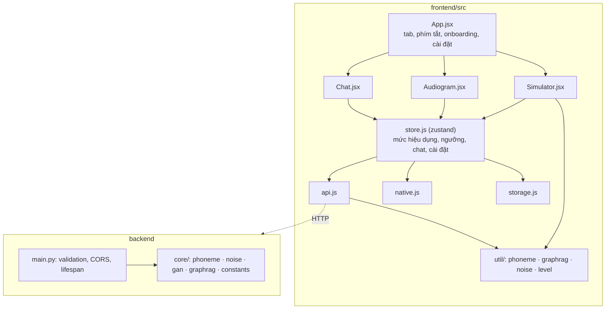

# Kiến trúc

## 1. Nguyên tắc

1. **Offline-first.** Mọi chức năng cốt lõi chạy trong máy người dùng; backend là tuỳ chọn (nhiễu do máy chủ sinh, LLM).
2. **Một mã nguồn cho mọi nền tảng.** Web, PWA, iOS, Android dùng chung `frontend/src`; phần gốc (rung, thanh trạng thái, lưu trữ) đi qua `native.js` và `storage.js`, an toàn khi chạy trên web.
3. **Hai bản cài đặt, một sự thật.** Python (`backend/core`) là tham chiếu; JavaScript (`frontend/src/util`) được so từng ca với Python (parity) và fuzz.
4. **Lùi tầng rõ ràng.** GAN → nhiễu thủ tục; LLM → câu trả lời tầng 1; máy chủ lỗi → engine trong máy. Không bao giờ để giao diện chết.
5. **Trung thực về mô hình.** Mô phỏng giáo dục, có câu miễn trừ; điều chưa kiểm chứng được ghi rõ ([testing.md](testing.md)).

## 2. Thành phần

| Mô-đun | Trách nhiệm |
|---|---|
| `store.js` | Trạng thái duy nhất: tab, ngôn ngữ, mức, ngưỡng, chat, cài đặt. `selectEffectiveLevel` = preset gần nhất với audiogram người dùng kéo, nên Simulator phản ứng với audiogram. |
| `api.js` | Gọi backend có timeout và phân loại lỗi (offline / timeout / 4xx / 5xx); ở chế độ `offline` hoặc khi mất mạng thì dùng engine trong máy. |
| `util/phoneme.js` | Làm rụng chữ: tách âm tiết tiếng Việt (âm đầu, nhân, âm cuối), phân band theo tần số, giọng Bắc/Nam; engine ký tự tiếng Anh. |
| `util/noise.js` | Nhiễu thủ tục bằng FFT: độ dốc phổ, nhấn dải theo kịch bản, lọc thông thấp theo mức, điều biên ~4 Hz; tuần hoàn nên lặp không có tiếng tách. |
| `util/graphrag.js` | GraphRAG tầng 1: chuẩn hoá bỏ dấu, chấm điểm theo từ khoá và điều kiện audiogram. Dữ liệu 6 nút do `tests/make_fixtures.py` sinh từ Python. |
| `native.js` / `storage.js` | Cầu nối Capacitor (rung, thanh trạng thái, màn hình chờ, Preferences) với đường lùi về Web API. |
| `backend/main.py` | Validation chặt (`Literal`, `Field`), CORS theo danh sách origin, `lifespan` đóng HTTP client, 7 route. |

## 3. Luồng chính

1. App mở → `loadSettings()` (đọc cài đặt đã lưu) → `initNative()` → `refreshBackend()`:
   - **Trong máy** (mặc định của app mobile và demo): `backend = "local"`, dùng hằng số cục bộ.
   - **Máy chủ**: `GET /presets` + `/sound-items` (hạn 5 giây); lỗi → `backend = "offline"` và vẫn chạy bằng engine trong máy.
2. **Chữ rụng** luôn tính cục bộ bằng `phoneme.js` (tức thì, không gọi mạng).
3. **Nhiễu**: máy chủ sinh WAV (`/noise`, mức Normal đủ dải) hoặc `noise.js` sinh tại chỗ; trình duyệt lọc thông thấp và đặt gain theo mức khi phát.
4. **Chat**: `/graphrag` (có thể có LLM) hoặc `graphrag.js`; luôn kèm câu miễn trừ.

## 4. Dữ liệu dùng chung (R-06)

`backend/core/constants.py` là nguồn chân lý của hằng số số học. Frontend giữ bản sao dự phòng (`data/constants.js`); `tests/make_fixtures.py` xuất fixture và `check-parity.mjs` so 8 nhóm hằng số + 111 ca chữ + 87 ca GraphRAG. Đổi backend mà quên cập nhật frontend thì CI đỏ (`test_parity_fixture_is_fresh`).

## 5. An toàn và quyền riêng tư

- Không thu thập dữ liệu; ở chế độ trong máy audiogram và câu hỏi không rời thiết bị. Chế độ máy chủ chỉ gửi 6 số ngưỡng và câu hỏi (≤ 500 ký tự).
- Backend giới hạn kích thước đầu vào, kiểm kiểu, CORS theo danh sách, không trả chi tiết lỗi LLM ra ngoài, `torch.load(weights_only=True)`.
- React tự escape nội dung; CSP của nginx (xem `frontend/nginx.conf`).
- Nội dung y tế luôn kèm câu miễn trừ; lời khuyên trong `graphrag` cần chuyên gia thính học rà soát trước khi phát hành rộng (xem báo cáo, mục O-10).

## 6. Giới hạn đã biết

Giọng đọc không đi qua bộ lọc (Web Speech API không cho lấy audio); GAN chưa kiểm chứng với checkpoint thật; mức dB của icon âm thanh và hằng số DSP chưa hiệu chuẩn; audiogram chỉ một tai, dẫn truyền khí. Chi tiết và đề xuất: [báo cáo rà soát](reports/Dr_Bunny_ra_soat_va_giai_thich_code.docx), mục 5.

## 7. Điểm mở rộng

- Thêm kịch bản: `backend/core/constants.py` (`SCENARIOS`) → `make fixtures` → `frontend/src/data/constants.js` (parity báo nếu quên) → cập nhật `gan.NUM_SCENARIOS` nếu dùng GAN.
- Thêm ngôn ngữ chữ: một `degradeTokens` mới trong `phoneme.js` và `phoneme.py` + ca fixture.
- Thêm nút tri thức: `NODES` trong `graphrag.py` + điều kiện trong `util/graphrag.js` + `make fixtures`.
