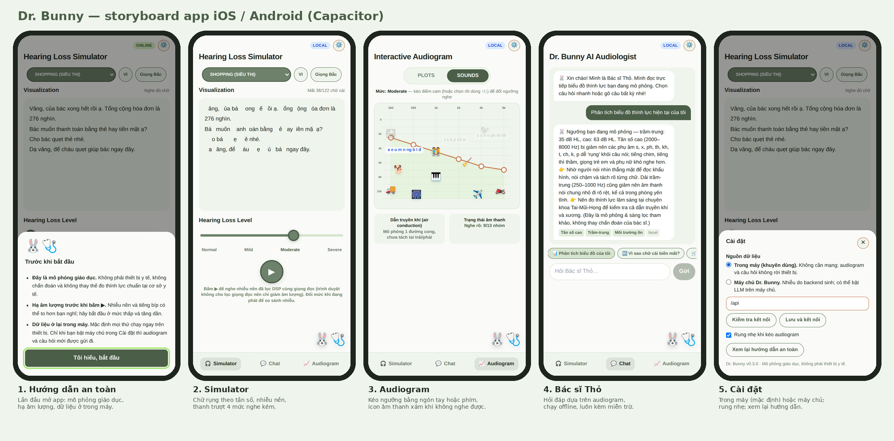
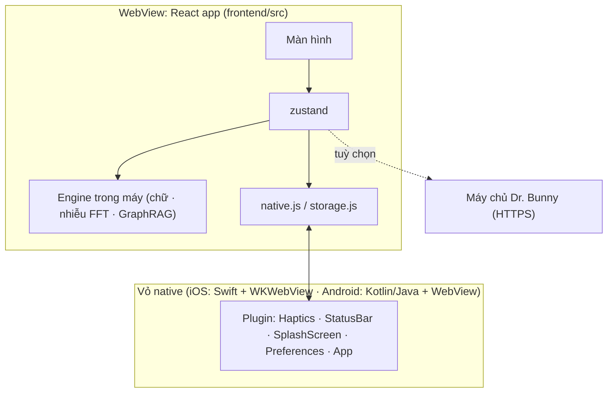
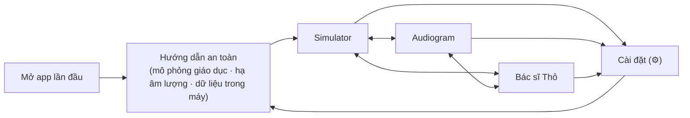

# Thiết kế app iOS / Android — Dr. Bunny

*Năm màn hình trên là ảnh chụp từ ứng dụng thật (viewport iPhone 14), không phải bản phác thảo. Ảnh đúng kích cỡ cửa hàng nằm ở `mobile/store/screenshots/`.*

## 1. Mục tiêu và phạm vi

**Mục tiêu:** giúp người dùng *cảm nhận* nghe kém ra sao (chữ không nghe rõ, nhiễu nền che phụ âm yếu) và hiểu vì sao, bằng một audiogram họ tự điều khiển.

| Persona | Nhu cầu | Điều app mang lại |
|---|---|---|
| Sinh viên y/kỹ thuật âm thanh | Hiểu audiogram, "speech banana" | Kéo ngưỡng và thấy ngay phụ âm nào rụng; bảng giải thích trong chat |
| Người thân của người nghe kém | Đồng cảm, biết cách nói chuyện | Trải nghiệm "mất phụ âm cao", mẹo giao tiếp từ Bác sĩ Thỏ |
| Người tự thấy nghe kém | Tò mò, chưa biết bắt đầu từ đâu | Gợi ý đi đo thính lực chuẩn; **không chẩn đoán** |

**Ngoài phạm vi (v1):** chẩn đoán, đo thính lực chuẩn, máy trợ thính, tài khoản đăng nhập, thu thập dữ liệu, thanh toán.

## 2. Công nghệ: Capacitor 8 + PWA

| Tiêu chí | PWA thuần | **Capacitor (chọn)** | React Native | Flutter |
|---|---|---|---|---|
| Tái dùng giao diện + engine đã test | 100 % | **100 %** | ~0 % (viết lại UI, DSP) | 0 % |
| Web Audio (lọc, điều biên) | có | **có** | cần thư viện native | viết lại |
| Có mặt trên App Store / Play | không | **có** | có | có |
| Rung, thanh trạng thái, vòng đời app | hạn chế (iOS) | **plugin chính thức** | có | có |
| Hiệu năng | WebView | WebView | native | native |

Lý do chi tiết: [ADR-0002](adr/0002-capacitor-for-mobile.md). Người không dùng cửa hàng vẫn cài được bản PWA (Add to Home Screen) và mở được khi mất mạng.

## 3. Kiến trúc app

- **Mặc định hoàn toàn trong máy** (`apiBase = "offline"`): không cần mạng, không gửi dữ liệu đi.
- Mất kết nối khi đang dùng máy chủ → tự lùi về engine trong máy, chat ghi rõ "đang offline".
- Cài đặt lưu bằng Capacitor Preferences (UserDefaults / SharedPreferences).

## 4. Luồng người dùng

Vòng lặp chính: **chỉnh ngưỡng (Audiogram) → cảm nhận (Simulator) → hỏi vì sao (Bác sĩ Thỏ)**. Chọn mức bằng thanh trượt hoặc kéo audiogram đều được; khi kéo, Simulator dùng *mức gần nhất* và nói rõ điều đó.

## 5. Màn hình

| Màn hình | Mục đích | Thành phần chính | Trạng thái đặc biệt |
|---|---|---|---|
| **Hướng dẫn an toàn** | Điều kiện tiên quyết (cửa hàng yêu cầu nói rõ không phải thiết bị y tế) | 3 ý ngắn + nút "Tôi hiểu"; chặn thao tác phía sau; focus vào nút | Hiện lần đầu; xem lại từ Cài đặt |
| **Simulator** | Cảm nhận | Chọn kịch bản, VI/EN, giọng Bắc/Nam; hộp chữ "Mất X/Y chữ cái"; thanh trượt 4 mức; nút ▶ | Đang tải nhiễu (vòng quay); dòng báo "đã tự kéo audiogram → mức gần nhất"; dừng khi xuống nền |
| **Audiogram** | Điều khiển | SVG 6 điểm kéo được; chế độ PLOTS/SOUNDS; icon âm thanh xám khi không nghe được | Rung nhẹ mỗi bước 5 dB; điều khiển bằng bàn phím và trình đọc màn hình |
| **Bác sĩ Thỏ** | Giải thích | Lịch sử hội thoại (giữ khi đổi tab), câu hỏi nhanh, ô nhập ≤ 500 ký tự | Trả lời trong máy; thẻ "local/hardcoded/llm"; luôn có câu miễn trừ |
| **Cài đặt** | Quyền kiểm soát | Chế độ dữ liệu (trong máy / máy chủ + kiểm tra kết nối), rung, xem lại hướng dẫn, phiên bản | Esc để đóng; địa chỉ máy chủ lưu bền |

**Điều hướng:** thanh tab dưới (3 mục, phím tắt 1/2/3 trên bàn phím ngoài), nút ⚙️ ở góc trên, nút thỏ nổi mở chat.

## 6. Tương tác chi tiết

- **Kéo audiogram:** vùng chạm bán kính 18 đơn vị SVG quanh mỗi điểm; ngưỡng làm tròn 5 dB; `touch-action: none` để không cuộn trang; cập nhật tối đa một lần mỗi khung hình; rung nhẹ khi đổi bước. Người dùng không kéo được dùng phím: ↑/↓ = 5 dB, PageUp/PageDown = 20 dB.
- **Phát âm thanh:** chỉ bắt đầu sau cú chạm (chính sách autoplay). Nhiễu fade-in 0,25 giây, đổi mức khi đang phát chỉ trượt tham số bộ lọc (không tải lại). Giọng đọc dùng `speechSynthesis`.
- **Xuống nền / có cuộc gọi:** app dừng nhiễu và giọng đọc khi `appStateChange` (không còn active) hoặc khi `AudioContext` rời trạng thái `running`.
- **Vùng chạm ≥ 44 px trên màn cảm ứng** (`@media (pointer: coarse)` trong `index.css`): thanh tab, nút ⚙️, nhãn mức, pill, ô chọn, ô nhập chat, nút Gửi, thanh trượt đều đo được cao đúng 44 px; icon âm thanh trên audiogram được mở rộng vùng chạm bằng phần tử giả (~45–48 px) mà không đổi kích thước hiển thị. Đo bằng Chromium ở viewport 390 px; cần kiểm lại trên thiết bị thật.
- **Phản hồi lỗi:** mỗi loại lỗi một câu riêng (offline / quá hạn / từ chối / lỗi máy chủ).

## 7. Tích hợp nền tảng

| Việc | iOS | Android | Trạng thái |
|---|---|---|---|
| Âm thanh khi bật công tắc im lặng | `AVAudioSession.playback` trong `AppDelegate.swift` | không cần | đã cấu hình, **cần thử trên máy thật** |
| Khoá chiều | iPhone chỉ dọc (`Info.plist`) | `screenOrientation="portrait"` | đã cấu hình |
| Thanh trạng thái | `StatusBar.setStyle(Light)` (chữ tối trên nền sáng) | cùng plugin | đã cài |
| Màn hình chờ | tự ẩn sau 800 ms và gọi `SplashScreen.hide()` khi app sẵn sàng | cùng plugin | đã cài, ảnh sinh từ `mobile/resources` |
| Rung | `Haptics.impact(Light)` | cùng plugin | đã cài; web dùng `navigator.vibrate` |
| Lưu cài đặt | Preferences (UserDefaults) | Preferences (SharedPreferences) | đã cài |
| Mã hoá xuất khẩu | `ITSAppUsesNonExemptEncryption = false` (chỉ HTTPS chuẩn) | — | đã cấu hình |
| Sao lưu đám mây | — | `allowBackup="false"` (cài đặt không đáng sao lưu) | đã cấu hình |
| Safe area / tai thỏ | `viewport-fit=cover` + `env(safe-area-inset-*)` | cùng | đã xử lý ở CSS |

## 8. Trợ năng

- Vai trò và nhãn đầy đủ: slider có `aria-valuetext`, hộp thoại `role="dialog" aria-modal`, tin nhắn `role="log" aria-live="polite"`, bộ đếm chữ `aria-live`.
- Điều khiển được hoàn toàn bằng bàn phím; `prefers-reduced-motion` tắt hiệu ứng.
- Cỡ chữ co giãn theo `rem`; tương phản dùng bảng màu sage đậm trên nền sáng.
- **Việc cần làm:** kiểm tra bằng VoiceOver và TalkBack thật; hộp chữ "rụng" có `aria-hidden` ở phần bị ẩn nên trình đọc chỉ đọc chữ còn lại — cân nhắc thêm nút "đọc văn bản gốc".

## 9. Hiệu năng

| Số đo | Giá trị | Ghi chú |
|---|---|---|
| Bundle JS / CSS | 199 KB (≈ 68 KB gzip) / 19 KB | `npm run build` |
| Sinh nhiễu 2,97 giây | ~55 ms | đo trong Node; chỉ chạy một lần mỗi kịch bản (cache) |
| Chữ rụng, 5000 ký tự | ~11 ms | đo trong Node |
| GraphRAG tầng 1 | ~0,1 ms | đo trong Node |

*Chưa đo trên thiết bị thật.* Mục tiêu đề xuất: mở app dưới 2 giây trên Android tầm trung, không rớt khung hình khi kéo audiogram. Việc cần làm: React Profiler (xem báo cáo, mục O-13), thử trên Pixel 4a / iPhone SE.

## 10. Quyền riêng tư và tuân thủ

- **Không thu thập dữ liệu, không tài khoản, không quảng cáo, không phân tích.** Ở chế độ trong máy, audiogram và câu hỏi không rời thiết bị.
- Chế độ máy chủ chỉ gửi 6 số ngưỡng và câu hỏi tới địa chỉ **do người dùng tự cấu hình**.
- App không xin quyền nào (không micro, không vị trí, không ảnh).
- Mẫu chính sách riêng tư và bảng khai báo cửa hàng: `mobile/store/`. **Phải đối chiếu với chính sách hiện hành** của Apple (mục 1 về an toàn/y tế và mục 5 về quyền riêng tư) và Google Play (Health apps, Data safety) trước khi nộp.
- Nội dung y tế: luôn kèm câu miễn trừ; lời khuyên trong `graphrag` cần chuyên gia thính học rà soát (báo cáo, O-10).
- **An toàn nghe:** hướng dẫn lần đầu nhắc hạ âm lượng; mức đỉnh tiếng bíp có trần 0,4. Chưa có bộ giới hạn âm lượng tổng (xem lộ trình).

## 11. Ngôn ngữ

Giao diện hiện bằng tiếng Việt; nội dung mô phỏng hỗ trợ tiếng Việt và tiếng Anh. Kế hoạch i18n giao diện (vi/en) bằng bảng chuỗi: v1.2.

## 12. Phát hành

1. **Định danh:** đổi `appId` (`app.drbunny.simulator`) trong `frontend/capacitor.config.json` sang tên miền của bạn *trước khi* tạo ứng dụng trên cửa hàng (không đổi được về sau).
2. **Phiên bản:** semver ở `frontend/package.json`; Android `versionCode`/iOS build number tăng ở mỗi lần nộp.
3. **Tài nguyên:** `make assets` (biểu tượng, màn hình chờ); ảnh cửa hàng ở `mobile/store/screenshots/`.
4. **Ký:** Android — keystore (hoặc Play App Signing); iOS — chứng chỉ và provisioning trong Xcode. **Không commit** khoá (đã chặn trong `.gitignore`).
5. **Kênh thử:** TestFlight (iOS), Internal testing (Play) → phát hành theo giai đoạn.
6. **Ghi chú cho người duyệt:** `mobile/store/review-notes.md`.

Chi tiết từng bước: [mobile/README.md](../mobile/README.md).

## 13. Kế hoạch kiểm thử mobile

| Hạng mục | Thiết bị / điều kiện |
|---|---|
| Kích thước | iPhone SE (nhỏ), iPhone 15 Pro, Pixel 4a, Pixel 8, Galaxy A-series |
| Phiên bản | iOS 16–18; Android 9–15 |
| Âm thanh | công tắc im lặng bật; cuộc gọi đến giữa chừng; tai nghe Bluetooth (độ trễ); khoá màn hình |
| Mạng | máy bay; chuyển từ máy chủ sang offline; máy chủ chậm (>20 s) |
| Trợ năng | VoiceOver, TalkBack, cỡ chữ lớn, giảm chuyển động |
| Vòng đời | xoay máy (đang khoá dọc), đa nhiệm, kill app rồi mở lại (cài đặt còn) |

## 14. Lộ trình mobile

| Bản | Nội dung |
|---|---|
| **1.0 (đã có trong repo)** | Ba màn hình + hướng dẫn + Cài đặt, offline-first, PWA, dự án Android/iOS, biểu tượng, CI |
| 1.1 | Plugin native TTS (iOS `AVSpeechSynthesizer.write`, Android `TextToSpeech.synthesizeToFile`) để **render giọng nói rồi lọc theo audiogram**; bộ giới hạn âm lượng tổng |
| 1.2 | i18n giao diện vi/en; lưu lịch sử chat |
| 1.3 | Hai tai, thêm 3 kHz và 6 kHz, dẫn truyền xương |
| 2.0 | Chế độ đo thính lực (cần xem xét quy định thiết bị y tế riêng) |

## 15. Rủi ro và giả định

| Rủi ro | Giảm thiểu |
|---|---|
| Web Audio trong WKWebView bị công tắc im lặng chặn | Đã đặt `AVAudioSession.playback`; **bắt buộc thử trên máy thật** |
| Cửa hàng từ chối vì "ứng dụng y tế" | Hướng dẫn lần đầu, câu miễn trừ, mô tả nói rõ là mô phỏng giáo dục, ghi chú cho người duyệt |
| Mô phỏng bị hiểu như chẩn đoán | Chuyên gia thính học duyệt nội dung; không hiển thị kết luận bệnh |
| Hiệu năng WebView trên máy yếu | Engine nhẹ (ms), cache nhiễu; đo trên Pixel 4a/iPhone SE trước khi phát hành |
| Nghe quá to gây khó chịu | Nhắc hạ âm lượng, trần biên độ; thêm bộ giới hạn ở 1.1 |
| Chưa biên dịch được native trong môi trường soạn repo | `mobile.yml` build debug trên runner Linux/macOS; xem [testing.md](testing.md) |

**Giả định:** nhóm chấp nhận WebView (không native thuần); backend là tuỳ chọn; giấy phép MIT; `OWNER` và `appId` sẽ được đổi.
