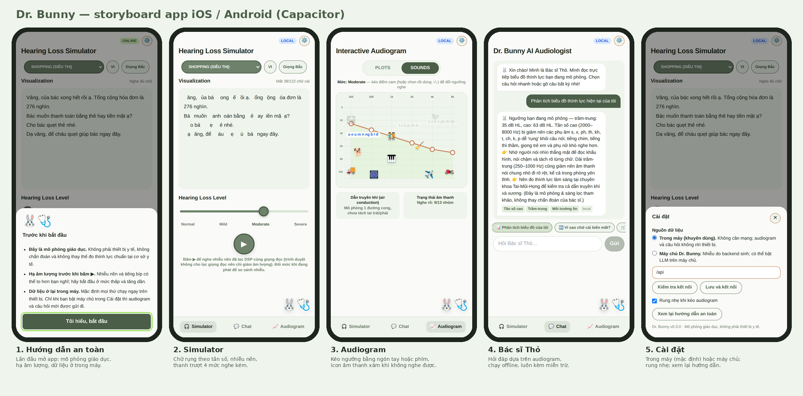
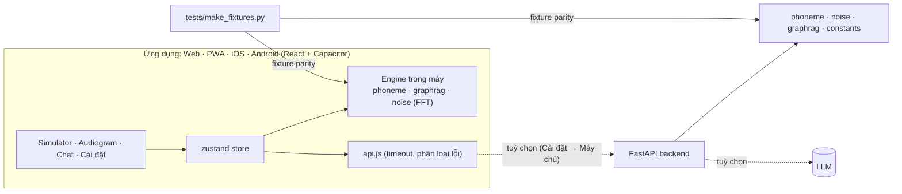

<div align="center">

# 🐰🩺 Dr. Bunny

**Mô phỏng trải nghiệm nghe kém — audiogram tương tác, chữ rụng theo tần số, nhiễu nền và Bác sĩ Thỏ.**
Web · PWA cài được · iOS · Android — cùng một mã nguồn, chạy **hoàn toàn offline**.

[](https://github.com/OWNER/dr-bunny/actions/workflows/ci.yml)
[](https://github.com/OWNER/dr-bunny/actions/workflows/pages.yml)


**[▶ Chạy demo ngay](https://claude.ai/artifact/Y3daqYo8dvotBtmhs299h1)** · [Tài liệu](docs/README.md) · [Thiết kế app mobile](docs/mobile-app-design.md) · [Báo cáo rà soát](docs/reports/Dr_Bunny_ra_soat_va_giai_thich_code.docx)



</div>

> **Thay `OWNER`** trong README, `.github/` và `docs/` bằng tài khoản GitHub của bạn sau khi tạo repo. Bản demo ở trên là liên kết riêng tư của người tạo; sau khi đẩy lên GitHub, workflow `pages.yml` sẽ đăng bản chạy được ở `https://OWNER.github.io/dr-bunny/`.

## Tính năng

| | |
|---|---|
| **Simulator** | Chữ trong hội thoại "rụng" theo tần số của âm vị (phụ âm cao rụng trước) ở 4 mức nghe kém; nhiễu nền lọc theo mức; giọng đọc. Tiếng Việt (tách âm tiết, giọng Bắc/Nam) và tiếng Anh. |
| **Audiogram** | Kéo thả hoặc dùng phím để đổi ngưỡng 6 tần số; icon âm thanh xám khi không nghe được; tiếng bíp mẫu. Simulator đổi theo audiogram bạn vẽ. |
| **Bác sĩ Thỏ** | Hỏi đáp dựa trên chính audiogram: 6 nút tri thức (GraphRAG), có thể bật LLM trên máy chủ. Luôn kèm câu miễn trừ. |
| **Offline-first** | Engine chữ, nhiễu thủ tục (FFT) và GraphRAG đều chạy ngay trong máy; backend chỉ là tuỳ chọn. Bản JavaScript được test song song với Python (parity) nên không thể lệch nhau âm thầm. |
| **Mobile** | Capacitor 8: dự án Android (Gradle) và iOS (Swift Package Manager) đã sinh sẵn; rung nhẹ, thanh trạng thái, màn hình chờ, biểu tượng. |

> ⚠️ **Đây là công cụ mô phỏng giáo dục, không phải thiết bị y tế**, không chẩn đoán và không thay thế đo thính lực chuẩn.

## Kiến trúc



Chi tiết: [docs/architecture.md](docs/architecture.md) · các quyết định kiến trúc: [docs/adr/](docs/adr/).

## Cấu trúc repo

```
dr-bunny/
├── backend/            FastAPI: main.py, core/ (phoneme, noise, gan, graphrag, constants), Dockerfile
├── frontend/           React 18 + Vite + Tailwind + zustand  (web, PWA, và là nguồn của app mobile)
│   ├── src/              components/, util/ (phoneme, graphrag, noise, level), store.js, api.js, native.js
│   ├── android/          dự án Android (Capacitor) — mở bằng Android Studio
│   ├── ios/              dự án iOS (Capacitor, Swift Package Manager) — mở bằng Xcode
│   ├── public/           manifest PWA, service worker, biểu tượng
│   └── scripts/          check-parity.mjs, logic.test.mjs, build-demo.mjs
├── mobile/             Thiết kế & phát hành app: resources/ (icon, splash), store/ (listing, quyền riêng tư), README
├── demo/               index.html — bản demo MỘT FILE, chạy bằng file:// hoặc đăng ở đâu cũng được
├── tests/              pytest, fixture parity, e2e Chromium (browser, review, mobile, demo, pwa)
├── docs/               architecture, api, testing, deployment, mobile-app-design, adr/, design/, reports/
├── legacy/             prototype gốc (index.html, backend_core.py) — chỉ để tham chiếu
├── .github/            CI, deploy Pages, build mobile, issue/PR templates, dependabot
├── docker-compose.yml  backend + web (nginx) trong một lệnh
└── Makefile            make help
```

## Bắt đầu nhanh

**Yêu cầu:** Python 3.12, Node 22; JDK 21 + Android Studio (Android); Xcode 16+ trên macOS (iOS).

```bash
make install            # pip + npm ci
make dev-api            # terminal 1: http://localhost:8000  (tài liệu API tự sinh: /docs)
make dev-web            # terminal 2: http://localhost:5173  (proxy /api sang :8000)
```

Không cần backend? Mở `demo/index.html` bằng trình duyệt, hoặc vào **Cài đặt → Trong máy**.

```bash
make demo               # dựng demo một file -> demo/index.html (và kiểm bằng Chromium)
make android            # build web, đồng bộ, mở Android Studio
make ios                # (macOS) build web, đồng bộ, mở Xcode
docker compose up --build   # bản đóng gói: http://localhost:8080
```

## Đẩy lên GitHub

```bash
scripts/set-owner.sh <tài-khoản-của-bạn>     # thay OWNER trong README, .github, docs
git init -b main && git add -A && git commit -m "feat: Dr. Bunny v0.3.0"
gh repo create dr-bunny --public --source=. --push      # hoặc tạo repo trên web rồi: git remote add origin … && git push -u origin main
```
Sau đó bật *Settings → Pages → Source: GitHub Actions* để có bản web chạy được; đổi `appId` theo [mobile/README.md](mobile/README.md) trước khi tạo ứng dụng trên cửa hàng.

## Kiểm thử

| Lệnh | Nội dung |
|---|---|
| `make test` | pytest (49) + đo GraphRAG + parity JS↔Python (111 ca chữ, 8 nhóm hằng số, 87 ca GraphRAG) + 20 test logic frontend |
| `make e2e` | Chromium thật: giao diện (16), hành vi cải tiến (17), trải nghiệm di động (13) |
| `make demo` | demo một file mở bằng `file://`, không gọi mạng (8) |
| `python tests/e2e_pwa.py` | PWA cài được và **mở được khi mất mạng** (5) |

Hướng dẫn chi tiết và những gì **chưa** được kiểm chứng (build native, GAN/LLM thật): [docs/testing.md](docs/testing.md).

## Tài liệu

- [Kiến trúc](docs/architecture.md) · [API](docs/api.md) · [Engine chạy trong máy](docs/offline-engines.md)
- [Thiết kế app iOS/Android](docs/mobile-app-design.md) · [Hướng dẫn build & phát hành mobile](mobile/README.md)
- [Triển khai](docs/deployment.md) · [Kiểm thử](docs/testing.md)
- [Báo cáo rà soát và giải thích từng dòng code](docs/reports/Dr_Bunny_ra_soat_va_giai_thich_code.docx) (bản đã rà soát dùng thư mục `fullstack/`; nay `backend/`, `frontend/`, `tests/` nằm ngay dưới gốc repo)
- Lịch sử dự án: [docs/history/](docs/history/)

## Đóng góp

Xem [CONTRIBUTING.md](CONTRIBUTING.md). Báo lỗ hổng bảo mật theo [SECURITY.md](SECURITY.md). Giấy phép [MIT](LICENSE).

---

## English summary

**Dr. Bunny** simulates the hearing-loss experience: an interactive audiogram, text whose letters "drop out" by phoneme frequency band, filtered background noise, and a small audiologist chatbot (GraphRAG, optional LLM). One React codebase ships as a website, an installable offline PWA, and iOS/Android apps via Capacitor 8. The letter-dropping engine, procedural noise (FFT) and GraphRAG all run on-device; the FastAPI backend is optional and the JavaScript ports are parity-tested against the Python reference. Try the single-file demo in `demo/index.html`. *Educational simulation — not a medical device.*
